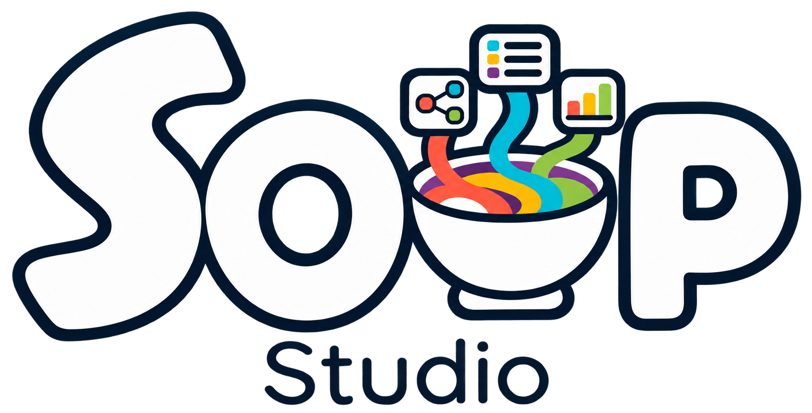
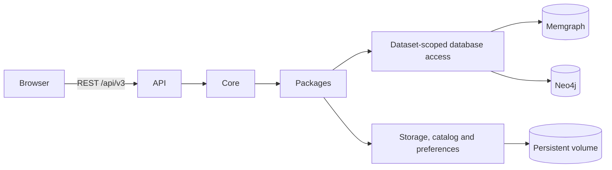
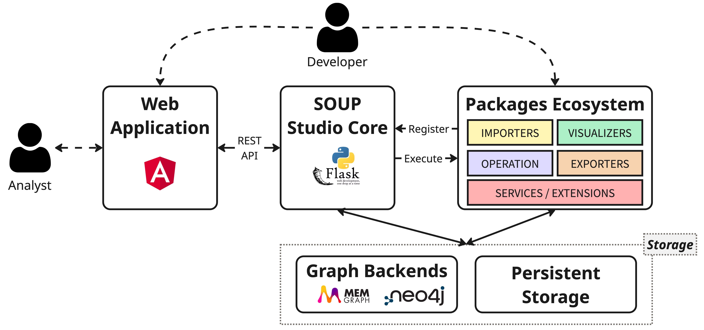

<p align="center">
  
</p>

# SOUP Studio


[](LICENSE)

**An extensible workspace for object-centric process mining.**

SOUP Studio lets you import event data, build and explore **Event Knowledge Graphs (EKGs)**,
create derived analyses, aggregate graphs, and discover process models. A shared workspace
organizes datasets, analyses, and models together with their provenance.

Its package architecture is inspired by [ProM](https://promtools.org/): the core coordinates
objects and contributions, while packages provide importers, operations, visualizers, and
exporters. Graph datasets can use **Memgraph or Neo4j**, according to the selected importer
and the packages available for that backend.

[Documentation](https://soup-ocpm.github.io/) ·
[Getting started](https://soup-ocpm.github.io/#/getting-started) ·
[Package development](https://soup-ocpm.github.io/#/development/packages) ·
[Package repository](https://github.com/soup-ocpm/soup-packages)

## Screencast

[](https://www.youtube.com/watch?v=TUWW9EIL6UU)

## Features

- **Event-data import:** CSV tables and event logs, OCEL 2.0, and OCED event/object tables through the corresponding packages.
- **Workspace and provenance:** keep source datasets, derived analyses, and discovered models connected through parent/child relationships.
- **Interactive graph exploration:** navigate EKGs, inspect properties, search nodes and relationships, and explore graphs incrementally with Graph Explorer.
- **Queries and statistics:** inspect activities, objects, relationships, and process indicators.
- **Derived analyses:** apply filters to create new analysis objects while preserving the source dataset.
- **Graph aggregation:** build class graphs and configure OCEAN aggregations through the available packages.
- **OC-DFG discovery:** use the PM4Py package on Memgraph-compatible inputs, with interactive frequency/performance views and SVG export.
- **Data and model export:** download the formats offered by each package, including graph JSON, CSV, OCEL 2.0 JSON, analysis configurations, reports, and SVG.
- **Runtime packages:** install and manage ZIP packages from the application; compatibility and dependencies determine their availability.
- **Graph backends:** work with Memgraph and configured external Neo4j instances through dataset-scoped database access.

See the [package catalog](https://soup-ocpm.github.io/#/packages/catalog) for individual package capabilities and requirements.
The [SOUP package repository](https://github.com/soup-ocpm/soup-packages) is available for package development and distribution.

## Quick start

You need [Git](https://git-scm.com/downloads) and
[Docker Desktop](https://www.docker.com/products/docker-desktop/).

```sh
git clone -b plugin-based https://github.com/soup-ocpm/soup.git
cd soup
docker compose -p soup-tool up --build
```

Then open:

- the application: <http://localhost:4200>;
- Memgraph Lab: <http://localhost:3300>.

To stop the application, run `docker compose -p soup-tool down`. Dataset and package volumes
are preserved. Local workspace contents are stored in Docker volumes; downloading the
repository does not copy another installation's datasets or saved analyses.

The default deployment publishes application and Memgraph ports on `127.0.0.1`.
See [External Neo4j](#external-neo4j) for the additional configuration needed by a remote database.

## First steps

The interface is in English. Start with the bundled
[order-management example](soup-app/public/help/order_process.csv).

1. Open **Import** at <http://localhost:4200/import> and select the example CSV.
2. Choose **CSV as event log (EKG on Memgraph)**. Map the event ID, timestamp, and activity
   columns, select entity columns such as `Order` and `Item`, and complete the import.
3. Open the resulting object from **Workspace** and select the **Graph** visualizer to explore its EKG.
4. Under **Actions**, choose **New analysis** to filter the dataset into a derived object.
5. On a compatible source, use **Discover OC-DFG (PM4Py)** to create a process model, or choose
   an aggregation operation. The available actions depend on the object's kind, backend, and active packages.

The [Getting started guide](https://soup-ocpm.github.io/#/getting-started) explains the workflow.

## Architecture



Packages declare the object kinds, tools, dependencies, and graph backends they support.
The core routes requests to their contributions and resolves graph access for the selected dataset.
See [Architecture](https://soup-ocpm.github.io/#/concepts/architecture) and
[Graph backends](https://soup-ocpm.github.io/#/concepts/graph-backends).


*SOUP Studio Architecture*

## Development

To prepare the backend environment (`soup-server/.venv`), run this from the repository root:

```sh
cd soup-app
npm run setup:server
```

See [Installation](https://soup-ocpm.github.io/#/getting-started/installation) for the environment
setup. Package-specific instructions are in each package's `README.md` under `soup-packages/`.
The [package development guide](https://soup-ocpm.github.io/#/development/packages) covers
contribution contracts, building, testing, and packaging extensions.

## Documentation

The documentation is available at **<https://soup-ocpm.github.io/>**.

| Page | What it covers |
|---|---|
| [Introduction](https://soup-ocpm.github.io/) | SOUP Studio and its main concepts. |
| [Getting started](https://soup-ocpm.github.io/#/getting-started) | Importing data and working with the application. |
| [Installation](https://soup-ocpm.github.io/#/getting-started/installation) | Deployment and environment setup. |
| [Architecture](https://soup-ocpm.github.io/#/concepts/architecture) | The core and package contributions. |
| [Datasets and workspaces](https://soup-ocpm.github.io/#/concepts/datasets) | Workspace objects and their relationships. |
| [Graph backends](https://soup-ocpm.github.io/#/concepts/graph-backends) | Memgraph and Neo4j configuration. |
| [Package overview](https://soup-ocpm.github.io/#/packages) | Package capabilities and organization. |
| [Package catalog](https://soup-ocpm.github.io/#/packages/catalog) | Individual packages and their requirements. |
| [Package development](https://soup-ocpm.github.io/#/development/packages) | Creating and distributing extensions. |

## Runtime graph backends

Graph datasets record `meta.backend` in the existing catalog; Neo4j datasets also
record their dedicated database name. Opening a different dataset selects its
backend for queries, transactions, visualizations and package availability. Graphs
are never copied between backends. Legacy catalog records are recognized from
their existing Memgraph dataset or explicit Neo4j database mapping.

For both backends in one application, configure `NEO4J_URI`, `NEO4J_USERNAME`,
`NEO4J_PASSWORD` and `SOUP_NEO4J_CSV_BASE_URL`, then use the normal
`docker compose -p soup-tool up --build`. For Neo4j on the Docker host, use
`bolt://host.docker.internal:7687`. Memgraph remains on host port 7689; the temporary
CSV server uses 8081. Neo4j must be able to reach that CSV address. The importer
chosen for each new dataset determines its backend; existing datasets are switched
through Workspace, not converted. `SOUP_DATABASE` is only the startup default.

Packages bind graph access with `ctx.database.for_dataset(object.id)`; the returned
connection stays bound to that dataset. Administrative access explicitly selects
`ctx.database.for_backend("neo4j").for_database("system")`. Missing, ambiguous or
unconfigured graph contexts fail without falling back. Memgraph keeps its existing
rebuild behavior and serializes complete operations while another workspace waits.
The standalone Neo4j Compose file remains available when Memgraph is not needed.
Runtime switching uses one application's catalog; separate deployment catalogs are
not merged automatically.

## External Neo4j

Memgraph remains the default (`docker compose -p soup-tool up --build`).
For a Neo4j-only deployment, use the standalone configuration and its own catalog/package volumes:

```sh
export NEO4J_URI=bolt://your-neo4j-host:7687
export NEO4J_USERNAME=neo4j
export NEO4J_PASSWORD='your-password'
export NEO4J_DATABASE=neo4j
export SOUP_NEO4J_CSV_BASE_URL=http://your-soup-host:8081
export SOUP_NEO4J_CSV_BIND_ADDRESS=0.0.0.0
docker compose -p soup-neo4j -f docker-compose.neo4j.yaml up --build
```


> [!TIP]
> If Neo4j is running on your host machine rather than inside Docker,
> you can configure the connection URI as follows:
>
> ```bash
> export NEO4J_URI=bolt://host.docker.internal:7687
> ```


Do not combine this file with `docker-compose.yaml`. It has no Memgraph services or
volumes and does not delete existing deployments. The two modes use the same browser
ports, so run one at a time. The CSV URL must be reachable **from Neo4j**; no shared
filesystem is needed. See [OCED importer setup](soup-packages/oced_importer/README.md).

Packages declare `"databases": ["memgraph"]`, `["neo4j"]`, or both; omission means
Memgraph only. Incompatible packages stay disabled during automatic discovery and
cannot be enabled, installed or loaded into the frontend for the selected backend.
The file-backed storage, SOUP Studio base, text and CSV-table packages support both modes.
Neo4j OCED imports require multi-database Enterprise support and CREATE/DROP DATABASE,
access, LOAD CSV, graph-write and index privileges. Each import creates its own database;
workspace deletion requires explicit confirmation and drops only its registered database.
`NEO4J_DATABASE` remains a legacy/administrative setting, never a dataset fallback.

Packages select `db = ctx.database.for_dataset(object.id)` before calling
`db.execute(cypher, parameters)` or `with db.transaction() as tx:`. Derived objects
resolve their database through catalog parents; ambiguous or missing mappings fail.
Administrative commands explicitly use `ctx.database.for_backend("neo4j").for_database("system")`.
SOUP Studio does not translate Cypher. Existing Memgraph graph queries remain unchanged.

## Credits

- **Developer for v1.0:** Alessio Giacché.
   - The v1.0 SOUP project is [soup/master](https://github.com/soup-ocpm/soup/tree/master).
- **Developer for v2.0:** Alessio Pianaroli.
  - Plugin architecture, package system and v3 API.
- **Contributors and maintainers:** Sara Pettinari; Lorenzo Rossi.

### 💡 New with v2.0
  - the core as a mediator of typed objects, contributions, tools, extension points and events;
  - the package system: manifests, loading, runtime installation from zips, frontends as Web
    Components with `@soup/sdk`;
  - the `/api/v3` HTTP API and the new host pages (import, workspace, object page, packages);
  - the EKG, OCEL, analysis, views and aggregated-graph packages, with the relationships of OCEL
    2.0 in the graph;
  - the backend without access to Docker, the test suites and the continuous integration.


> [!NOTE]
> **🍜 A little sip of SOUP**
>
> SOUP Studio builds on the original SOUP project. 
> Its rainbow-noodle logo represents the interconnected 
> objects and events considered in object-centric process mining.

## License

SOUP Studio is released under the [MIT License](LICENSE).
