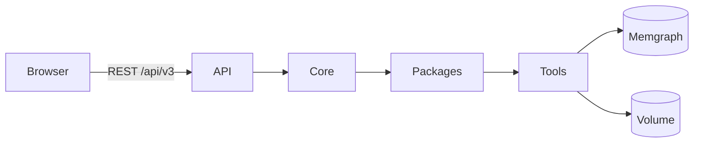

<p align="center">
  
</p>

# SOUP


[](LICENSE)

## What is SOUP

SOUP is a web application for **object-centric process mining**. It reads event logs, builds an
**Event Knowledge Graph (EKG)** on Memgraph 3.13.2 and lets you explore, filter, aggregate and export
it. Its plugin architecture is inspired by [ProM](https://promtools.org/): a small core that only
mediates, and packages that contribute everything else.

## Features

- **Import** CSV event logs and OCEL 2.0 logs, choosing the importer and how to read the file.
- **Graph and statistics** of every EKG, with several views of the graph.
- **Queries** ready to run on the events, the entities and their relationships.
- **Non-destructive analyses**: filters create a new, derived object and the original stays.
- **Aggregated graph** of the classes of events per entity type.
- **Export** of the graph as JSON, analysis configurations, CSV tables, OCEL 2.0 JSON and reports.
- **Packages installable at runtime**: every feature comes from a package, also while the app runs.

## Quick start

You need [Git](https://git-scm.com/downloads) and
[Docker Desktop](https://www.docker.com/products/docker-desktop/).

```sh
git clone -b plugin-based https://github.com/soup-ocpm/soup.git
cd soup
docker compose -p soup-tool up --build
```

Then open:

- the app: <http://localhost:4200>
- Memgraph Lab: <http://localhost:3300>

To stop it, run `docker compose -p soup-tool down`. Your datasets stay in their volumes.

Local use only: the ports are published on 127.0.0.1 only.

## First steps

The interface is in Italian, so the labels below are the ones you will see. The example file is
[soup-app/public/help/order_process.csv](soup-app/public/help/order_process.csv).

1. Open <http://localhost:4200/import> and choose the example file.
2. Choose the importer **CSV come event log** (CSV as an event log), tick the entity columns
   (**Colonne entità**), for example `Order` and `Item`, and press **Importa** (Import).
3. In the page of the new object, choose **Grafo** (Graph) under **Visualizzatore** (Visualizer).
4. Under **Azioni** (Actions), try **Nuova analisi** (New analysis): filter the graph into a new object.

The [User guide](https://github.com/AlessioPiana54/soup/wiki/User-guide) goes through every page.

## Architecture in one picture



The core only mediates: it loads the packages and routes the requests to them. Packages contribute
importers, operations, visualizers and exporters, and reach Memgraph and the dataset files through
tools. More in [Architecture](https://github.com/AlessioPiana54/soup/wiki/Architecture).

## Development

To prepare the backend environment (`soup-server/.venv`), run this from the repository root:

```sh
cd soup-app
npm run setup:server
```

The rest of the setup is in [Installation](https://github.com/AlessioPiana54/soup/wiki/Installation),
and the test and lint commands are in
[Testing and CI](https://github.com/AlessioPiana54/soup/wiki/Testing-and-CI).

## Documentation

| Page | What it covers |
|---|---|
| [Home](https://github.com/AlessioPiana54/soup/wiki) | The starting page and the example files. |
| [Installation](https://github.com/AlessioPiana54/soup/wiki/Installation) | Docker Compose, the volumes and their backup, local development. |
| [User guide](https://github.com/AlessioPiana54/soup/wiki/User-guide) | Importing, the workspace, the visualizers, analyses, exports and packages. |
| [Architecture](https://github.com/AlessioPiana54/soup/wiki/Architecture) | The core, typed objects, contributions, tools, extension points and events. |
| [Writing a package](https://github.com/AlessioPiana54/soup/wiki/Writing-a-package) | A complete package, step by step. |
| [API v3](https://github.com/AlessioPiana54/soup/wiki/API-v3) | Every route of `/api/v3`, with examples. |
| [Package reference](https://github.com/AlessioPiana54/soup/wiki/Package-reference) | Each shipped package and all the environment variables. |
| [Security](https://github.com/AlessioPiana54/soup/wiki/Security) | Local use, requests from other sites and trusted packages. |
| [Testing and CI](https://github.com/AlessioPiana54/soup/wiki/Testing-and-CI) | The test suites, the lint, the smoke tests and GitHub Actions. |
| [Troubleshooting](https://github.com/AlessioPiana54/soup/wiki/Troubleshooting) | Common problems and known limitations. |
| [Changelog](https://github.com/AlessioPiana54/soup/wiki/Changelog) | What changed in the 2026 rework, by area. |

## Credits

- **Original author:** Alessio Giacché.
- **Contributors:** Sara Pettinari; research activities with Lorenzo Rossi.
- **Plugin architecture, package system and v3 API by Alessio Pianaroli (2026):**
  - the core as a mediator of typed objects, contributions, tools, extension points and events;
  - the package system: manifests, loading, runtime installation from zips, frontends as Web
    Components with `@soup/sdk`;
  - the `/api/v3` HTTP API and the new host pages (import, workspace, object page, packages);
  - the EKG, OCEL, analysis, views and aggregated-graph packages, with the relationships of OCEL
    2.0 in the graph;
  - the backend without access to Docker, the test suites and the continuous integration.

The original project is [soup-ocpm/soup](https://github.com/soup-ocpm/soup).

> 💭 Our tool is called _Soup_, with a logo showcasing a mix of rainbow noodles, symbolizing the
> dynamic and interconnected flow of object-centric process mining, much like the iconic image of
> rainbow spaghetti.

## License

SOUP is released under the [MIT License](LICENSE).

## External Neo4j

Memgraph remains the default (`docker compose -p soup-tool up --build`).
Neo4j uses a separate, standalone configuration and its own catalog/package volumes:

```sh
export NEO4J_URI=bolt://your-neo4j-host:7687
export NEO4J_USERNAME=neo4j
export NEO4J_PASSWORD='your-password'
export NEO4J_DATABASE=neo4j
export SOUP_NEO4J_CSV_BASE_URL=http://your-soup-host:8081
export SOUP_NEO4J_CSV_BIND_ADDRESS=0.0.0.0
docker compose -p soup-neo4j -f docker-compose.neo4j.yaml up --build
```

```sh
export NEO4J_URI=bolt://host.docker.internal:7687
export NEO4J_USERNAME=neo4j
export NEO4J_PASSWORD='12341234'
export NEO4J_DATABASE=neo4j
export SOUP_NEO4J_CSV_BASE_URL=http://localhost:8081
export SOUP_NEO4J_CSV_BIND_ADDRESS=0.0.0.0
docker compose -p soup-neo4j -f docker-compose.neo4j.yaml up --build
```

Do not combine this file with `docker-compose.yaml`. It has no Memgraph services or
volumes and does not delete existing deployments. The two modes use the same browser
ports, so run one at a time. The CSV URL must be reachable **from Neo4j**; no shared
filesystem is needed. See [OCED importer setup](soup-packages/oced_importer/README.md).

Packages declare `"databases": ["memgraph"]`, `["neo4j"]`, or both; omission means
Memgraph only. Incompatible packages stay disabled during automatic discovery and
cannot be enabled, installed or loaded into the frontend for the selected backend.
The file-backed storage, SOUP base, text and CSV-table packages support both modes.
New packages use `ctx.database.execute(cypher, parameters)` and
`with ctx.database.transaction() as tx: tx.execute(cypher, parameters)`; SOUP does not
translate database-specific Cypher. Existing Memgraph graph queries remain unchanged.
